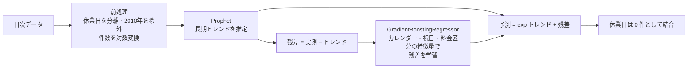

# 引越し需要予測（SIGNATE「アップル 引越し需要予測」）


引越し業者が時期ごとの人員配置や価格設定を決めるために、**日ごとの引越し受注件数を予測する機械学習モデル**を構築しました。
題材は [SIGNATE のコンペ「アップル 引越し需要予測」](https://user.competition.signate.jp/ja/competition/detail/?competition=ada98a13ab224468b1c7191d819d7646) です。

**分析結果（出力付きノートブック）はこちらから閲覧できます。**

| ノートブック | 内容 | 閲覧（GitHub Pages） |
| --- | --- | --- |
| [`EDA.ipynb`](notebooks/EDA.ipynb) | 探索的データ分析、前処理方針の検討 | [EDA.html](https://t0bbut.github.io/signate_apple_hikkosi_analysis/EDA.html) |
| [`model_年月日_曜日_祝日_価格の和差積.ipynb`](notebooks/model_年月日_曜日_祝日_価格の和差積.ipynb) | 特徴量作成、モデル学習・評価、予測 | [model.html](https://t0bbut.github.io/signate_apple_hikkosi_analysis/model_年月日_曜日_祝日_価格の和差積.html) |

> リポジトリ内のノートブックは出力を消した状態で管理しています。グラフなどの出力は上の HTML でご確認ください。

## 概要

### 課題

- **データ**: 2010-07-01〜2016-03-31 の日次データ（引越し件数、休業日フラグ、法人案件フラグ、午前・午後の料金区分）
- **予測対象**: 2016-04-01〜2017-03-31 の日ごとの引越し件数
- **評価指標**: MAE（平均絶対誤差）

### アプローチ

件数の変動を「長期的なトレンド」と「日々の細かな変動」に分け、それぞれを別のモデルで捉えて組み合わせました。



1. **前処理**: 休業日（`close = 1`）は件数が必ず 0 なのでルールで処理し、学習から除外。料金区分が欠損している 2010 年も除外。右に裾の長い分布を対数変換で整えた。
2. **トレンドモデル（Prophet）**: 年々増えていく緩やかな需要の伸びを推定。これにより、年ごとに右へずれていた分布の中心が揃う。
3. **変動モデル（勾配ブースティング）**: トレンドとの残差を、年月日・曜日・祝日・GW/SW/お盆・月初月末・料金区分の和差積など 23 個の特徴量で学習。
4. **検証**: 未来のデータが学習に混ざらないよう、年単位で区切った時系列交差検証（前年までで学習し翌年で検証）を使用。ハイパーパラメータは Optuna で探索し、最適なパラメータで最終モデルを学習。

### 設計の判断

なぜこの構成・この検証方法にしたのかを、EDA で確かめた事実とあわせてまとめます（詳細は [EDA.html](https://t0bbut.github.io/signate_apple_hikkosi_analysis/EDA.html)）。

- **トレンドを別モデルに分けた理由**: 件数は年々増えており、年ごとに分布の中心が右へずれていく。決定木系のモデルは学習データの範囲の外へ外挿できないため、そのまま学習すると翌年の件数を小さく見積もってしまう。そこで緩やかな増加を Prophet に任せ、勾配ブースティングにはその差分（残差）だけを学習させた。トレンドを引いたあと、年ごとの残差の分布の中心が揃うことを図で確認している。
- **対数変換を選んだ理由**: トレンドを除いても、件数が増えるほど振れ幅も大きくなる（不均一分散）ことが残差から分かった。対数変換と Box-Cox 変換（λ = 1/2, 1/10）を残差の歪度・尖度で比べ、変換の順番（変換してからトレンドを引く／引いてから変換する）も試したうえで、件数を対数変換してからトレンドを引く形にした。
- **「年」で区切って検証した理由**: 年（1〜12 月）と年度（4〜3 月）で区切った推移を比べ、年度で区切ると 3〜4 月の繁忙期のピークが 2 つに分かれてしまうため、年で区切ることにした。検証は「前年までで学習し、翌年で検証する」形の時系列交差検証を自作し、未来のデータが学習に混ざらないようにした。
- **ルールで決まる部分は機械学習に任せない**: 件数 0 の日は休業日とほぼ一致していたので、休業日は 0 件とルールで決め、学習からは除外した。お盆なのに休業日フラグが立っておらず件数 0 だった 2 日（2010-08-18, 2011-08-14）も、翌年以降は休業日になっていたため同じ扱いにした。料金区分がすべて欠損している 2010 年も学習から外した。
- **料金区分の積は「+1」してから計算**: 料金区分の 0 は「最安」であって「無い」ではない。そのまま掛け算すると最安値の日は積が必ず 0 になり情報が消えるため、`(price_am + 1) × (price_pm + 1)` とした。この特徴量は重要度の上位に入っている。

### 結果

- 予測誤差は平均して **±7 件程度**（年単位の時系列交差検証で MAE 6.18 件）で、引越し需要の予測に有用な精度が得られた。

  | 検証年 | 2012 | 2013 | 2014 | 2015 | 2016（1〜3月） | 平均 |
  | --- | --- | --- | --- | --- | --- | --- |
  | MAE（件） | 5.42 | 6.52 | 5.59 | 6.52 | 6.85 | **6.18** |

  ※ Prophet は学習データ全体で fit しているため、検証年のトレンド情報がわずかに含まれており、実際の誤差はこれより少し大きい可能性があります。
- 特徴量重要度が高かったのは、年内の時期（`ordinal_day`）、月内の日（`day`）、曜日（`day_of_week`）、料金区分の和・積（`price_sum`, `price_product`）。
- 課題: 繁忙期（3〜4月）のピークへの追従が弱い。実務では「繁忙期にどれだけ需要が来るか」が重要なため、評価指標や繁忙期向けの特徴量の見直しが今後の改善点。

### EDA で分かったこと（抜粋）

- 引越し件数は年々増加傾向にあり、3〜4月の繁忙期に大きなピークがある。
- 件数 0 の日は休業日（年末年始・お盆）とほぼ一致する。
- 2014 年 5 月から法人案件フラグが立ち始め、フラグのある日は件数がやや多い。
- 料金区分は繁忙期に高く設定されており、午後は午前より安い傾向がある。

## ディレクトリ構成

```
.
├── notebooks/            # 分析ノートブック（出力は削除済み）
│   ├── EDA.ipynb
│   └── model_年月日_曜日_祝日_価格の和差積.ipynb
├── docs/                 # 出力付きノートブックの HTML（GitHub Pages で公開）
├── data/
│   ├── input/            # train.csv / test.csv を置く場所（Git 管理外）
│   └── output/           # sample_submit.csv、予測結果の出力先（Git 管理外）
├── pyproject.toml        # 依存ライブラリの定義
├── uv.lock               # 依存バージョンの固定（uv）
└── .python-version       # 使用する Python のバージョン（3.14）
```

## 環境構築と再現手順

依存関係は [uv](https://docs.astral.sh/uv/) で管理しており、`uv.lock` によってライブラリのバージョンを固定しています。
uv が Python 3.14 も自動で用意するため、事前に Python をインストールしておく必要はありません。

### 1. uv のインストール

```bash
# macOS / Linux
curl -LsSf https://astral.sh/uv/install.sh | sh

# Windows (PowerShell)
powershell -ExecutionPolicy ByPass -c "irm https://astral.sh/uv/install.ps1 | iex"
```

### 2. リポジトリの取得と依存ライブラリのインストール

```bash
git clone https://github.com/T0bbuT/signate_apple_hikkosi_analysis.git
cd signate_apple_hikkosi_analysis
uv sync --locked
```

### 3. データの配置

コンペのデータは SIGNATE の規約により再配布できないため、リポジトリには含めていません。
[コンペページ](https://user.competition.signate.jp/ja/competition/detail/?competition=ada98a13ab224468b1c7191d819d7646)から入手したファイルを以下のように配置してください（詳細は [data/README.md](data/README.md)）。

```
data/input/train.csv
data/input/test.csv
data/output/sample_submit.csv
```

> 2025 年 8 月時点で、コンペの開催は終了しておりデータはダウンロードできなくなっています。

### 4. ノートブックの実行

```bash
# JupyterLab を起動してノートブックを開く
uv run jupyter lab

# もしくは、コマンドラインから実行して HTML に書き出す（docs/ の HTML はこの方法で生成）
cd notebooks
uv run jupyter nbconvert --to html --execute EDA.ipynb model_年月日_曜日_祝日_価格の和差積.ipynb --output-dir ../docs
```

ノートブックは `EDA.ipynb` → `model_…ipynb` の順に読むと流れが追いやすいです（それぞれ単独でも実行できます）。
Optuna の探索などには乱数シードを固定しているため、同じ環境であれば同じ結果が得られます。

## 使用技術

| 用途 | ライブラリ |
| --- | --- |
| データ処理 | polars, pandas, NumPy |
| 時系列トレンド | Prophet |
| 機械学習・検証 | scikit-learn（GradientBoostingRegressor, TimeSeriesSplit） |
| ハイパーパラメータ探索 | Optuna |
| 可視化 | matplotlib, seaborn, Plotly |
| 祝日判定 | jpholiday |
| 環境管理 | uv |

## 参考

- [SIGNATE「アップル 引越し需要予測」](https://user.competition.signate.jp/ja/competition/detail/?competition=ada98a13ab224468b1c7191d819d7646)
- [Tremendous1192 様「SIGNATE SOTA アップル 引越し需要予測 備忘録」](https://zenn.dev/tremendous1192/articles/ea6e73359ee764)
